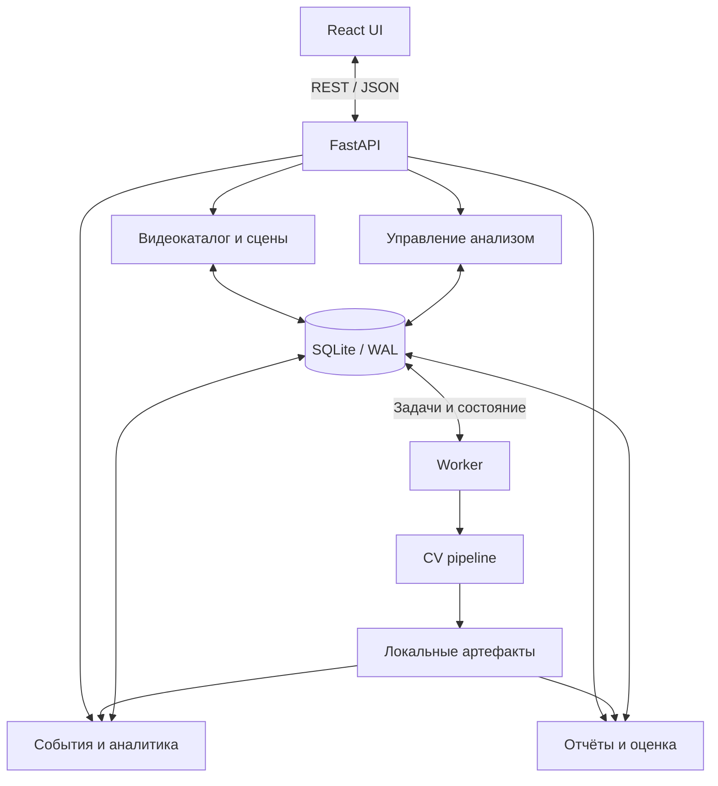
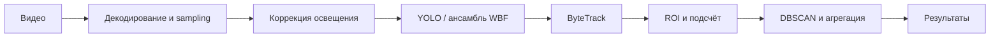

# InnovaTransport — анализ транспортных потоков

[](https://www.python.org/)
[](https://react.dev/)
[](https://fastapi.tiangolo.com/)
[](https://tailwindcss.com/)
[](https://docs.ultralytics.com/)
[](https://www.sqlite.org/)
[](https://docs.docker.com/compose/)

**InnovaTransport** — локальное веб-приложение для автоматизированного анализа транспортных и пешеходных потоков по видеозаписям. Система объединяет компьютерное зрение, интерактивную настройку зон подсчёта, проверку событий и формирование аналитических отчётов.

В основе проекта — компонентный интерфейс на **React**, модульный backend на **FastAPI** и отдельный worker для ресурсоёмких задач компьютерного зрения.

> Исходные видеозаписи, модели, база данных и результаты анализа хранятся локально. После установки зависимостей и подготовки весов обработка не требует внешних сервисов.

## 📌 О проекте

Ручной подсчёт транспорта требует значительных временных затрат и затрудняет повторный анализ. InnovaTransport автоматизирует обработку видеозаписей, сохраняя возможность экспертной проверки и корректировки результата.

Проект ориентирован на учебные и исследовательские задачи: изучение загруженности перекрёстков, анализ направлений движения и оценку пешеходных потоков.

## 🎯 Возможности

| Модуль | Функциональность |
| --- | --- |
| Видеокаталог | Загрузка MP4, MOV, MKV, AVI и WebM, просмотр записей и метаданных |
| Редактор сцен | Настройка ROI и линий въезда/выезда, повторное использование сохранённых сцен |
| Управление анализом | Очередь задач, настройка моделей и частоты выборки кадров, прогресс, история и отмена |
| Computer Vision | Детекция YOLO, сопровождение ByteTrack, быстрый режим и ансамбль моделей с WBF |
| Освещение | Дневной, ночной и автоматический режимы, подключение отдельных ночных весов |
| Проверка событий | Просмотр рамок и траекторий, подтверждение, исключение, добавление и редактирование событий |
| Аналитика | KPI, распределение по категориям, временные интервалы, матрица направлений и картограмма |
| Кластеризация | Группировка направленных траекторий с помощью DBSCAN |
| Экспорт | Отчёты в JSON, CSV и XLSX |
| Оценка качества | Сопоставление результатов с независимой эталонной разметкой |

Поддерживаемые классы: пешеходы, велосипеды, мотоциклы, легковые автомобили, автобусы и грузовики.

## 🧭 Рабочий процесс

1. Загрузить видеозапись и выбрать её в каталоге.
2. Включить автоматический подсчёт либо настроить область интереса (ROI) и контрольные линии.
3. Выбрать профиль детекции, режим освещения и частоту обработки кадров.
4. Запустить анализ и отслеживать состояние задачи.
5. Проверить найденные события, при необходимости внести исправления.
6. Изучить статистику, направления движения и картограмму.
7. Экспортировать результаты или сопоставить их с эталонной разметкой.

## 🧩 Архитектура

Проект построен как **модульный монолит с отдельным процессом обработки видео**. Пользовательский интерфейс отделён от серверной логики на уровне исходного кода и взаимодействует с backend через REST API. При развёртывании FastAPI обслуживает как API, так и собранный frontend; отдельный Node.js-сервер в runtime не нужен.



### Frontend

Интерфейс реализован на React 18 с разделением на переиспользуемые компоненты и hooks для работы с состоянием и серверным API.

- `frontend/components/` — визуальные и функциональные блоки приложения: видео, конфигурация анализа, редактор и результаты.
- `frontend/hooks/` — загрузка данных и периодическое обновление состояния задач.
- `frontend/main.jsx` — точка входа приложения.
- `static/assets/` — локально собранные JS и CSS.

Сборку JavaScript выполняет esbuild, стили обрабатываются Tailwind CSS. Интерфейс рассчитан на использование с desktop и мобильных экранов.

### Backend

HTTP-интерфейс разбит на тематические маршрутизаторы FastAPI. Контракты запросов валидируются отдельно от обработчиков, а вычисления CV и геометрии вынесены из HTTP-слоя.

| Модуль | Ответственность |
| --- | --- |
| `app/api/media.py` | Работа с видеозаписями |
| `app/api/counting.py` | Конфигурация подсчёта и сцен |
| `app/api/analysis.py` | Управление жизненным циклом анализа |
| `app/api/results.py` | Агрегация, события, ревизии и отображение детекций |
| `app/api/reports.py` | Формирование файлов отчётов |
| `app/api/evaluation.py` | Приём эталонной разметки и оценка |
| `app/api/schemas.py` | Схемы данных API |
| `app/storage.py` | SQLite и локальные пути хранения |
| `app/worker.py` | Выполнение задач анализа вне HTTP-процесса |

Снимок геометрии сохраняется для каждого запуска. Редактирование события использует контроль версии записи, чтобы предотвратить перезапись изменений из другой вкладки.

### Computer Vision pipeline



| Компонент | Назначение |
| --- | --- |
| YOLO11s | Детекция в быстром профиле |
| Weighted Boxes Fusion (WBF) | Объединение предсказаний двух моделей в ансамбле |
| ByteTrack | Сохранение идентичности объектов между кадрами |
| ROI и линии | Определение области наблюдения и направлений движения |
| DBSCAN | Поиск групп схожих траекторий без задания числа кластеров |

Ночная обработка использует коррекцию яркости и контраста. Она не заменяет специализированный обученный детектор; при наличии собственных ночных весов их можно подключить к анализу.

## 🛠 Технологический стек

| Уровень | Технологии |
| --- | --- |
| Frontend | React 18, JavaScript / JSX, Tailwind CSS 3.4 |
| Сборка | Node.js, npm, esbuild |
| Backend | Python 3.11/3.12, FastAPI, Uvicorn |
| Computer Vision | Ultralytics YOLO, PyTorch, Supervision / ByteTrack, WBF |
| Видео и вычисления | FFmpeg, PyAV, OpenCV, NumPy, SciPy |
| Хранение | SQLite (WAL), локальная файловая система |
| Отчёты | JSON, CSV, openpyxl / XLSX |
| Тестирование | pytest, Playwright |
| Развёртывание | Docker, Docker Compose |

## 📁 Структура репозитория

Основные каталоги и файлы (сокращённое дерево):

```text
traffic-analysis/
├── app/
│   ├── api/                    # тематические REST-модули
│   ├── vision/                 # декодирование и освещение
│   │   ├── frames.py
│   │   └── lighting.py
│   ├── main.py                 # сборка FastAPI-приложения
│   ├── worker.py               # обработчик очереди
│   ├── ensemble.py             # детекция и трекинг
│   ├── geometry.py             # ROI и пересечения
│   ├── clustering.py           # кластеризация траекторий
│   ├── evaluation.py           # вычисление метрик
│   ├── cartogram.py             # визуализация потоков
│   └── storage.py              # SQLite и файловые пути
├── frontend/
│   ├── components/             # React-компоненты
│   ├── hooks/                  # логика состояния и API
│   └── main.jsx                # точка входа React
├── static/                     # HTML, исходные стили, сборка frontend
├── data/
│   └── models/                 # локальные веса моделей
├── scripts/                    # сборка, веса, обучение и benchmark
├── tests/                      # автоматические тесты backend
├── docs/                       # требования, методики и проверки
├── .github/workflows/          # автоматизация GitHub Actions
├── .env.example
├── DESIGN.md
├── package.json
├── package-lock.json
├── tailwind.config.js
├── requirements.txt
├── requirements-dev.txt
├── Dockerfile
└── docker-compose.yml
```

## 🚀 Быстрый запуск

### Через Docker Compose (рекомендуемый способ)

Понадобятся Git, Python для загрузки весов и Docker с Compose.

```bash
git clone https://github.com/ne5ermind/traffic-analysis.git
cd traffic-analysis

# Веса быстрого профиля
python3 scripts/fetch_weights.py --model yolo11s.pt

# Сборка frontend и запуск API + worker
docker compose up --build -d
```

Для ансамблевого режима дополнительно подготовьте веса:

```bash
python3 scripts/fetch_weights.py --ensemble
```

| Сервис | Адрес |
| --- | --- |
| Веб-интерфейс | [http://127.0.0.1:8000](http://127.0.0.1:8000) |
| Swagger UI | [http://127.0.0.1:8000/docs](http://127.0.0.1:8000/docs) |

Docker использует многоступенчатую сборку: Node.js компилирует интерфейс, затем готовые файлы копируются в Python-образ. Compose запускает `api` и `worker` с общим томом данных. Лимиты по умолчанию: 1 CPU и 1 ГБ памяти для API, 3 CPU и 5 ГБ для worker.

Просмотр логов и остановка:

```bash
docker compose logs -f api worker
docker compose down
```

### Локальный запуск без Docker

Требуются Python 3.11/3.12, Node.js 20+, FFmpeg и системные библиотеки OpenCV.

```bash
python3.12 -m venv .venv
source .venv/bin/activate
pip install -r requirements-dev.txt

npm ci
npm run build

python scripts/fetch_weights.py --model yolo11s.pt
uvicorn app.main:app --host 127.0.0.1 --port 8000
```

В отдельном терминале из корня проекта:

```bash
source .venv/bin/activate
python -m app.worker
```

После изменения React-компонентов или стилей пересоберите интерфейс:

```bash
npm run build
```

Готовый frontend обслуживается FastAPI на том же порту 8000.

### Конфигурация

| Переменная | Назначение |
| --- | --- |
| `INNOVA_DEVICE` | Устройство вычислений: по умолчанию `cpu`; локально на совместимом Mac можно явно указать `mps` |
| `INNOVA_DATA` | Альтернативный каталог данных; по умолчанию `data/` |

Веса размещаются в каталоге `models/` внутри каталога данных. Их необходимо подготовить до запуска анализа.

## 🔌 REST API

| Метод | Маршрут | Назначение |
| --- | --- | --- |
| `GET` / `POST` | `/api/videos` | Каталог и загрузка видео |
| `GET` | `/api/videos/{id}/media` | Получение видео или preview |
| `GET` / `POST` | `/api/scenes` | Работа со сценами |
| `GET` / `POST` | `/api/runs` | Список и создание задач анализа |
| `GET` / `PATCH` | `/api/runs/{id}` | Статус, отмена или изменение топологии |
| `GET` | `/api/runs/{id}/results` | Сводка, события, картограмма, кластеры и производительность |
| `POST` / `PATCH` | `/api/runs/{id}/events` | Добавление и исправление событий |
| `GET` | `/api/runs/{id}/export/{format}` | Экспорт JSON, CSV или XLSX |

Для запроса отдельного раздела результатов предусмотрен параметр `view`: `summary`, `events`, `cartogram`, `detections`, `clusters`, `performance` или `all`.

Вспомогательные маршруты оценки качества:

| Метод | Маршрут | Назначение |
| --- | --- | --- |
| `POST` | `/api/videos/{id}/ground-truth` | Загрузка эталона |
| `GET` | `/api/runs/{id}/evaluate/{reference_id}` | Сравнение с эталоном |

Маршруты оценки скрыты из публичной схемы OpenAPI. Согласованные контракты основного API доступны в [Swagger UI](http://127.0.0.1:8000/docs).

## ✅ Тестирование и оценка качества

### Автоматические проверки

```bash
pytest -q tests
python -m compileall -q app tests scripts
npm run build
docker compose config --quiet
```

### Браузерные тесты

Playwright проверяет основные сценарии интерфейса на изолированном наборе данных.

```bash
# Установка браузера (Linux)
npx playwright install --with-deps chromium

# Тестовые данные и отдельный экземпляр API
INNOVA_DATA=/tmp/innova-ui python scripts/seed_ui.py
INNOVA_DATA=/tmp/innova-ui uvicorn app.main:app --port 8017
```

В другом терминале:

```bash
npm run test:ui
```

### Производительность

Полный benchmark запускается на видеозаписи длительностью не менее 15 минут. В выбранном каталоге данных предварительно разместите необходимые веса в `models/`.

```bash
INNOVA_DATA=/path/to/benchmark-data python scripts/benchmark_full.py \
  /path/to/15-minute-video.mp4 --lighting night
```

Для проверки NF-01 используйте ограничения CPU, эквивалентные штатному Docker Compose. Опубликованные результаты и условия измерения находятся в [VERIFICATION.md](./docs/VERIFICATION.md).

### Оценка точности

Для проверки трекинга предусмотрены Precision, Recall, F1, MOTA и IDF1; для количественного подсчёта — MAE, RMSE и WAPE. Необходим независимый размеченный эталон. Подробности форматов и протокола: [RESEARCH_AND_EVALUATION.md](./docs/RESEARCH_AND_EVALUATION.md).

Подготовленный скрипт обучения ночного детектора можно использовать с собственным размеченным набором:

```bash
python scripts/train_night.py --data /path/to/dataset.yaml --epochs 50
```

## 👥 Команда и зоны ответственности

| Участник | Зона ответственности | Issues |
| --- | --- | --- |
| [@ne5ermind](https://github.com/ne5ermind) | Загрузка, каталог и проигрывание видео | [#43](https://github.com/ne5ermind/traffic-analysis/issues/43), [#44](https://github.com/ne5ermind/traffic-analysis/issues/44) |
| [@Gov1-10dav](https://github.com/Gov1-10dav) | Очередь, прогресс и отмена анализа | [#45](https://github.com/ne5ermind/traffic-analysis/issues/45), [#46](https://github.com/ne5ermind/traffic-analysis/issues/46) |
| [@skillshifting](https://github.com/skillshifting) | Детекция, трекинг и video overlay | [#47](https://github.com/ne5ermind/traffic-analysis/issues/47), [#48](https://github.com/ne5ermind/traffic-analysis/issues/48) |
| [@qqqquinke](https://github.com/qqqquinke) | Зоны подсчёта и проверка событий | [#49](https://github.com/ne5ermind/traffic-analysis/issues/49), [#50](https://github.com/ne5ermind/traffic-analysis/issues/50) |
| [@zhorarichka-a11y](https://github.com/zhorarichka-a11y) | Агрегация, картограмма и экспорт | [#51](https://github.com/ne5ermind/traffic-analysis/issues/51), [#52](https://github.com/ne5ermind/traffic-analysis/issues/52) |

## 📚 Документация

| Документ | Содержание |
| --- | --- |
| [Функциональные требования](./docs/FR.md) | Требования к функциональности системы |
| [Нефункциональные требования](./docs/NFR.md) | Производительность, надёжность и другие ограничения |
| [Реестр требований](./docs/REQUIREMENTS.md) | Учёт требований |
| [Методика исследований](./docs/RESEARCH_AND_EVALUATION.md) | Алгоритмы, метрики, научные источники и протокол оценки |
| [Результаты проверок](./docs/VERIFICATION.md) | Тестирование и измерения производительности |
| [DESIGN.md](./DESIGN.md) | Документ проектирования |
| [Каталог документации](./docs/) | Дополнительные материалы проекта |

## ⚠️ Ограничения метода

Точность результатов зависит от положения камеры, освещения, перекрытия объектов, качества детекции, трекинга и частоты выборки кадров. При редкой выборке кратковременно видимые объекты могут быть пропущены.

Автоматический режим учитывает устойчивые уникальные треки, а режим с пользовательской геометрией — события пересечения заданных линий. Результаты этих режимов сопоставимы только при согласованных правилах подсчёта.

Кластеры траекторий описывают движение в координатах изображения, а не реальные географические направления. Ночная предобработка и синтетические тесты сами по себе не доказывают улучшение точности.

InnovaTransport является исследовательским инструментом и не претендует на статус сертифицированной системы транспортного мониторинга. Для применения на новых данных необходима отдельная оценка качества на репрезентативной размеченной выборке.
