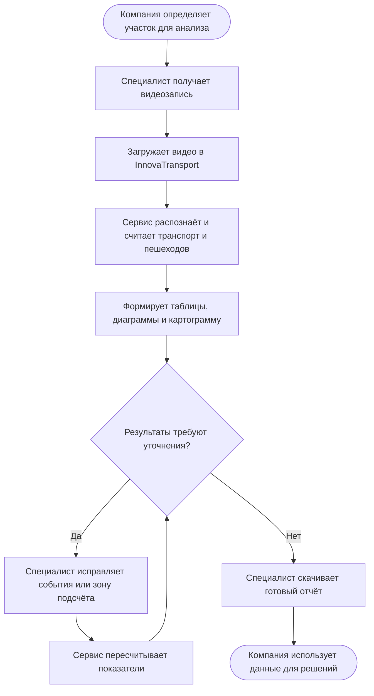

# Упрощённая TO-BE — процесс для компании

Эта схема показывает InnovaTransport с точки зрения компании или заказчика без технических деталей. Специалист загружает видеозапись, сервис автоматически подготавливает результаты, после проверки компания получает готовый отчёт для принятия решений.

Функциональные и нефункциональные требования, а также способы их проверки собраны в [`REQUIREMENTS.md`](./REQUIREMENTS.md).

Основной результат процесса — не просто подсчёт объектов, а понятные таблицы, диаграммы и картограмма, которые можно использовать при настройке светофоров, изменении разметки и планировании организации движения.

Исходник исходной swimlane-диаграммы: [`TO-BE-COMPANY.puml`](./TO-BE-COMPANY.puml).

Диаграмма охватывает путь от постановки задачи до использования отчёта при настройке светофоров, разметки и организации движения.
