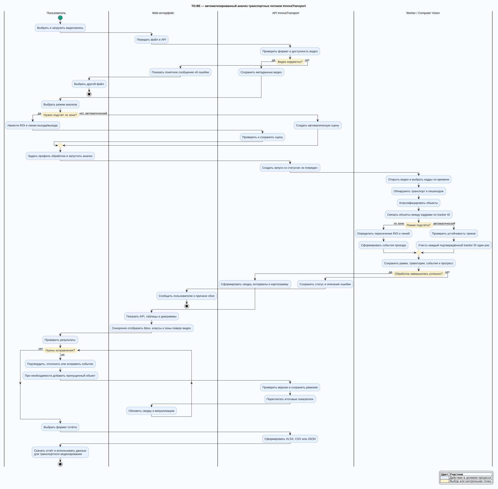

# TO-BE — целевой процесс InnovaTransport

Целевая модель показывает, как ручной просмотр видеозаписей заменяется управляемым процессом автоматизированного анализа. Пользователь загружает видео, выбирает автоматический подсчёт или работу по размеченной зоне, запускает обработку и проверяет полученные события перед экспортом отчёта.

Для общего объяснения проекта без технических деталей подготовлена [упрощённая TO-BE для компании](./TO-BE-COMPANY.md).

Диаграмма выполнена в нотации **UML Activity Diagram** с дорожками участников:

- пользователь;
- web-интерфейс;
- API InnovaTransport;
- worker и модуль компьютерного зрения.

Исходник диаграммы: [`TO-BE.puml`](./TO-BE.puml).

Диаграмма охватывает функциональные требования ФТ-1—ФТ-10: загрузку видео, запуск анализа, обнаружение и классификацию объектов, трекинг, подсчёт, настройку зоны, визуализацию, проверку событий и экспорт результатов.

